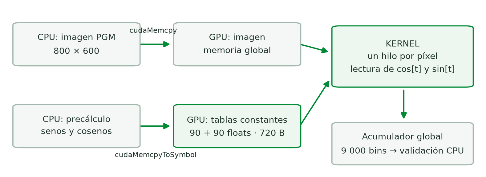
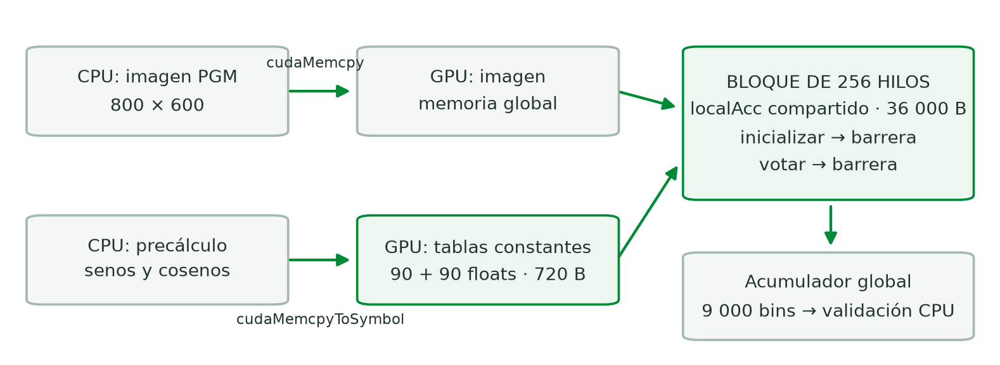
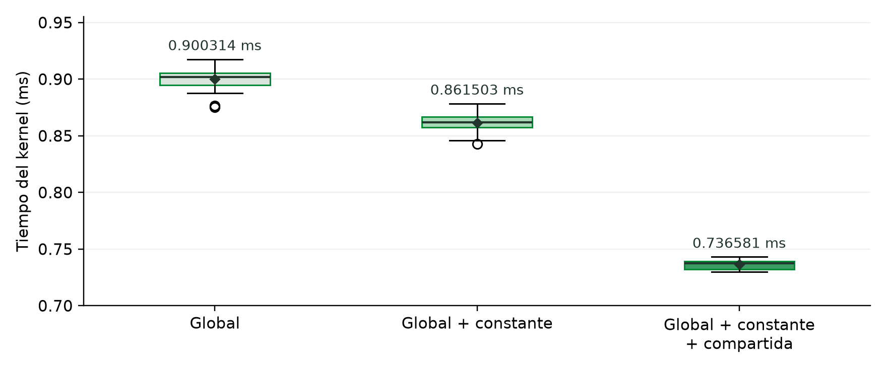
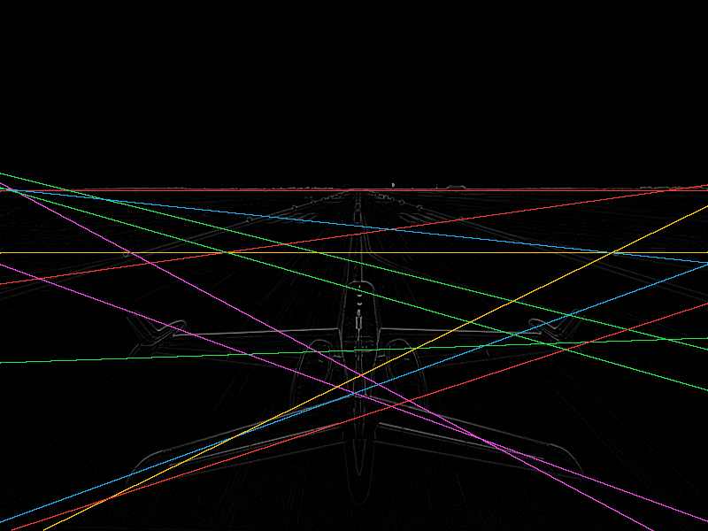

# Resumen

Se implementó la transformada lineal de Hough con CUDA para identificar líneas rectas en una imagen PGM y evaluar el efecto de la ubicación de las tablas trigonométricas y del acumulador de votos. Se conservaron tres variantes requeridas: memoria global; global con constante; y global, constante y compartida. La CPU se utilizó como referencia de exactitud, comparando los 9 000 contadores en cada lanzamiento medido.

La comparación principal se ejecutó en una Tesla T4 de Google Colab con la misma imagen de 800 × 600 píxeles y la misma configuración de 1 875 bloques de 256 hilos. Se reportaron 60 mediciones por variante, distribuidas en seis rondas con órdenes distintos. El tiempo medio del kernel fue 0.900314 ms para global, 0.861503 ms para constante y 0.736581 ms para las tres memorias: una reducción de 18.19 % entre la versión final y la global. El resultado se limita a la imagen, GPU y protocolo utilizados.

La versión final también exporta el acumulador validado y produce una imagen PNG con doce líneas a color mediante un umbral de votos y supresión de líneas vecinas. El código, las mediciones originales, los diagramas y las evidencias se conservan en el repositorio del equipo.

<!-- pagebreak -->

# 1. Introducción y objetivos

La detección de líneas es una operación útil para analizar estructuras presentes en una imagen, como bordes, pistas y objetos con contornos rectos. La transformada de Hough convierte ese problema geométrico en un proceso de votación: cada píxel activo aporta evidencia a las rectas que podrían pasar por él y las combinaciones de parámetros con más votos se consideran candidatas [1].

La paralelización resulta natural porque distintos hilos pueden procesar píxeles diferentes. Sin embargo, esos hilos pueden incrementar el mismo contador. Por ello, el rendimiento depende tanto del cálculo de coordenadas como de la organización de la memoria y de la coordinación de las actualizaciones concurrentes. Este proyecto estudió ese comportamiento mediante cambios controlados entre variantes.

## Objetivo general

Implementar y validar la transformada lineal de Hough en CUDA, y comparar el tiempo de su kernel al utilizar memoria global, constante y compartida.

## Objetivos específicos

- Completar la versión global con índices seguros, comprobación de errores y liberación de recursos.
- Almacenar los valores precalculados de seno y coseno en memoria constante.
- Acumular votos por bloque en memoria compartida y combinar los resultados de forma segura.
- Medir el kernel con CUDA Events, conservar bitácoras y dibujar las líneas seleccionadas sobre la imagen original.

## Fundamento del algoritmo

La parametrización utilizada es rho = x · cos(theta) + y · sin(theta), donde rho representa la distancia con signo respecto al origen y theta el ángulo de la normal a la recta. El programa evalúa 90 ángulos, desde 0 hasta 178 grados en incrementos de 2 grados, y discretiza las distancias en 100 bins. El acumulador tiene 90 × 100 = 9 000 contadores [1].

Cada píxel con valor mayor que cero emite un voto por ángulo. No se añadió un detector de bordes ni un umbral de intensidad distinto: se conservó el criterio del código base. En runway.pgm hay 138 406 píxeles activos; por ello, el acumulador recibe 12 456 540 votos. Los valores de los bins sirven para seleccionar rectas candidatas, no para identificar automáticamente los extremos de cada segmento visible.

<!-- pagebreak -->

# 2. Implementación CUDA y versión global

La imagen se lee con una clase PGM que admite formatos P2 y P5 de 8 bits. Antes de reservar los datos, se validan formato, dimensiones, rango de intensidad y longitud del archivo. Los píxeles se almacenan en un vector que administra su propia memoria. La referencia CPU y las variantes GPU usan las mismas tablas de senos y cosenos para evitar diferencias innecesarias en la asignación de votos.

## Distribución del trabajo y coordenadas

Se utiliza una malla unidimensional y un hilo por píxel. El identificador global se calcula con gloID = blockIdx.x · blockDim.x + threadIdx.x. El número de bloques es (n + 255) / 256 con división entera. Así se cubren también imágenes cuyo tamaño no es múltiplo de 256.

La columna es gloID % width y la fila es gloID / width. Las coordenadas cartesianas se obtienen con x = columna − width/2 y y = height/2 − fila. El primer cálculo traslada el origen al centro horizontal; el segundo lo traslada al centro vertical e invierte el eje Y, ya que las filas de una imagen crecen hacia abajo.

El radio máximo es sqrt(width² + height²)/2 y la escala es 2 · rMax / 100. El índice radial se calcula a partir de (rho + rMax)/rScale y se limita al intervalo [0, 99] para que el extremo positivo y el redondeo no produzcan un acceso fuera del acumulador.

## Memoria global y concurrencia

En la versión inicial, imagen, tablas trigonométricas y acumulador se reservan en memoria global de la GPU. La CPU copia los datos, limpia el acumulador y lanza el kernel. Un hilo fuera de la imagen termina antes de acceder a los píxeles. Esta salida temprana es válida en las versiones sin barreras de bloque.

Los votos utilizan atomicAdd. Tener un hilo por píxel no evita una condición de carrera: dos píxeles distintos pueden pertenecer a la misma recta y votar por el mismo bin. Una suma ordinaria podría perder actualizaciones. La referencia CPU es secuencial y no necesita esa protección.

## Exactitud y recursos

Se comprueban los códigos de retorno de CUDA y se comparan todos los bins con la CPU. Una diferencia hace que el programa termine con error. La compilación utiliza -O2 -std=c++17 --fmad=false para conservar el orden aritmético utilizado en la comparación.

Los buffers y eventos usan RAII: se liberan al salir de su ámbito, incluso ante excepciones. Los vectores administran los datos de CPU y cudaDeviceReset se ejecuta al finalizar la sesión de GPU. La CPU se emplea como referencia de exactitud; no se midió una aceleración GPU frente a CPU.

<!-- pagebreak -->

# 3. Uso de memoria constante

La variante constante declara d_Cos[90] y d_Sin[90] mediante __constant__, con alcance global en el módulo CUDA. Los valores se calculan una vez en la CPU y se cargan con cudaMemcpyToSymbol. El kernel accede directamente a los símbolos; se eliminan los dos punteros de sus argumentos y sus reservas con cudaMalloc. La imagen y el acumulador permanecen en memoria global.

La elección responde al patrón de acceso: los valores son de solo lectura y los hilos que participan en una iteración leen el mismo índice angular. La memoria constante admite difusión de una dirección leída por un warp; accesos a direcciones diferentes pueden reducir esa ventaja [2]. En este código las tablas ocupan únicamente 720 bytes.



## Efecto observado

En la comparación final, la variante constante promedió 0.861503 ms frente a 0.900314 ms de la global: 4.31 % menos tiempo de kernel. La inspección con cuobjdump confirmó 720 bytes en el segmento constante del módulo. Esta cifra corresponde a las tablas explícitas; no significa que el kernel carezca de otros parámetros almacenados por el compilador.

La mejora fue moderada. Una interpretación compatible con el código es que las tablas globales, al ser pequeñas y reutilizadas, ya se benefician de las cachés, mientras que los votos atómicos siguen accediendo al acumulador global. El efecto de las cachés y los cuellos de botella debe analizarse mediante el patrón de acceso, no solo por el nombre de la memoria [3]. No se utilizó un perfilador para separar esos costos.

<!-- pagebreak -->

# 4. Uso de memoria compartida y versión final

La versión final combina las tablas constantes con un acumulador local por bloque: __shared__ int localAcc[9000]. Cada bloque de 256 hilos inicializa cooperativamente sus contadores, vota sobre ellos y, al terminar, suma los bins con votos al acumulador global. Se usan operaciones atómicas tanto para los votos locales como para la combinación entre bloques.

El arreglo ocupa 36 000 bytes por bloque. Antes del lanzamiento se comprueba que la GPU disponga de suficiente memoria compartida; en la Tesla T4 utilizada el límite informado por bloque fue 49 152 bytes. cuobjdump confirmó los 36 000 bytes compartidos y los 720 bytes de tablas constantes en el kernel final.



## Barreras y bloques parciales

La primera llamada a __syncthreads() asegura que se haya terminado de poner localAcc en cero antes de votar. La segunda asegura que todos los votos locales estén completos antes de combinarlos con el acumulador global. La memoria compartida es accesible por los hilos de un bloque y requiere coordinación cuando comparten datos [2].

Los hilos fuera de la imagen no regresan antes de esas barreras. La condición de píxel válido rodea solo el procesamiento del píxel; todos los hilos siguen participando en inicialización, sincronización y combinación. Esto evita que un bloque parcial deje hilos esperando en una barrera a la que otros nunca llegan.

La versión final promedió 0.736581 ms: 14.50 % menos que la constante y 18.19 % menos que la global. El ahorro es compatible con agrupar votos dentro del bloque antes de escribir al acumulador global. La inicialización, las barreras y el volcado local siguen teniendo costo y están incluidos en el tiempo del kernel.

<!-- pagebreak -->

# 5. Metodología experimental

Se utilizó Google Colab porque el equipo local no dispone de una GPU NVIDIA. La tabla resume las condiciones registradas en las evidencias; no se mezclaron sesiones distintas para calcular la comparación principal.

| Parámetro | Configuración registrada |
| --- | --- |
| Plataforma | Google Colab, Tesla T4 |
| Compilación | CUDA Toolkit 13.0; nvcc V13.0.88; driver 580.82.07 |
| Opciones | -O2 -std=c++17 --fmad=false |
| Entrada | runway.pgm; 800 × 600; PGM de 8 bits |
| Geometría | 1 875 bloques; 256 hilos por bloque |
| Acumulador | 100 radios × 90 ángulos; contadores int |
| Comparación | Mismo equipo y sesión; seis órdenes de ejecución |

## Medición con CUDA Events

Se registran eventos de inicio y fin en el mismo stream alrededor del lanzamiento del kernel. Se espera el evento final y se calcula el intervalo en milisegundos con cudaEventElapsedTime. Esto mide trabajo de GPU sin confundir el lanzamiento asíncrono con su finalización [4].

La reserva de memoria, las transferencias, la puesta a cero del acumulador, la comparación CPU/GPU y la exportación quedan fuera del intervalo. En cambio, la inicialización del acumulador compartido y sus barreras están dentro del kernel y sí forman parte de su tiempo. El acumulador se reinicia antes de cada lanzamiento para evitar sumar votos de ejecuciones anteriores.

## Protocolo de la comparación principal

Primero se realizaron 2 000 ejecuciones descartadas de la versión global para estabilizar la GPU. Después se recorrieron las seis permutaciones del orden de las tres variantes: G-C-F, G-F-C, C-G-F, C-F-G, F-G-C y F-C-G. Cada variante ocupó dos veces cada posición, lo que ayuda a equilibrar el efecto del orden, aunque no garantiza eliminar toda deriva temporal.

Cada ejecución del programa incluyó un calentamiento excluido y cien lanzamientos medidos y validados. Se conservaron como muestra reportada los últimos diez de cada ronda: sesenta por variante, ciento ochenta en total. El notebook registró el estado de la GPU antes y después de cada ejecución; durante las rondas se observó P0, reloj de SM entre 1 575 y 1 590 MHz y temperatura entre 64 y 66 °C.

La comparación se ejecutó sobre el commit 95049968a8d6e87b2783c224ba030b8cb68e8bf6. El criterio de últimos diez se conservó para dar continuidad al protocolo de fase 4. También se revisó la sensibilidad al utilizar los cien lanzamientos completos.

<!-- pagebreak -->

# 6. Resultados comparativos

Las siguientes estadísticas se recalcularon a partir de los CSV de las seis rondas. La desviación estándar es muestral. Todos los registros reportados indican coincidencia con CPU.

| Variante | n | Media (ms) | Desv. estándar (ms) | Mín. (ms) | Máx. (ms) |
| --- | --- | --- | --- | --- | --- |
| Global | 60 | 0.900314 | 0.008122 | 0.875328 | 0.917568 |
| Global + constante | 60 | 0.861503 | 0.008013 | 0.842784 | 0.878368 |
| Global + constante + compartida | 60 | 0.736581 | 0.003769 | 0.729824 | 0.743104 |



Se calcula reducción de tiempo = 100 · (tiempo de referencia − tiempo de variante) / tiempo de referencia; el factor de aceleración es tiempo de referencia / tiempo de variante. La constante redujo 4.31 % respecto a global (1.045×); la versión final redujo 18.19 % respecto a global (1.222×) y 14.50 % respecto a constante (1.170×). Son comparaciones entre kernels GPU.

Las medias por ronda mantienen el mismo orden: final, constante y global, de menor a mayor tiempo.

| Ronda | Global (ms) | Constante (ms) | Tres memorias (ms) |
| --- | --- | --- | --- |
| 1 | 0.901405 | 0.856518 | 0.737869 |
| 2 | 0.901430 | 0.866262 | 0.731971 |
| 3 | 0.898061 | 0.863472 | 0.731898 |
| 4 | 0.888086 | 0.862710 | 0.737485 |
| 5 | 0.903971 | 0.849664 | 0.739552 |
| 6 | 0.908928 | 0.870394 | 0.740714 |

<!-- pagebreak -->

# 7. Discusión y limitaciones

## Efecto de las optimizaciones

La memoria constante eliminó los punteros de tablas del kernel y cambió su vía de lectura, pero conservó el mismo esquema de votos globales. Por ello, su reducción de tiempo fue pequeña frente a la modificación adicional del acumulador por bloque. La versión final agrupa votos en localAcc antes de hacer la combinación global; esta es la diferencia principal respecto a la variante constante.

La reducción adicional de 14.50 % es consistente con un beneficio de esa reorganización. Sin embargo, no permite separar exactamente el costo de los atómicos, las barreras, la ocupación y las cachés. La versión intermedia global + compartida se conserva, pero no se midió con el mismo protocolo final; tampoco se utilizó Nsight. No se asume que los efectos de ambas memorias sean aditivos.

## Sensibilidad al tramo y al entorno

Al usar los cien lanzamientos de cada ejecución, los tiempos medios aproximados fueron 0.8780 ms para global, 0.8520 ms para constante y 0.7375 ms para la versión final. La reducción final frente a global sería aproximadamente 16.0 %, en lugar de 18.19 %. La conclusión sobre el orden de las variantes se mantiene, pero el porcentaje exacto depende del tramo.

La global y la constante mostraron una subida de tiempo dentro de algunas ejecuciones. El estado de GPU se muestreó antes y después, no de forma continua; no se determinó una causa única. No se atribuye todo el cambio al reloj o a la temperatura. Los tiempos iniciales de fase 2 y los de fase 4 corresponden a otras sesiones y se conservan como bitácoras históricas, no como referencias directas para esta comparación.

## Alcance estadístico y funcional

Las sesenta observaciones por variante provienen de seis ejecuciones y no son necesariamente independientes. El notebook incluye pruebas de Welch, pero sus valores p tratan esos lanzamientos como independientes y pueden exagerar la certeza. El informe prioriza los tamaños del efecto y la consistencia en las seis rondas, sin afirmar generalización estadística.

Solo se estudió una imagen principal y una Tesla T4. La densidad de píxeles activos, el número de bins, el tamaño de bloque y la arquitectura pueden cambiar los resultados. No se midió el tiempo completo de lectura, transferencias, validación y dibujo. El uso de 36 000 bytes compartidos por bloque puede afectar los bloques residentes, pero no se midió la ocupación efectiva; esa explicación queda como hipótesis.

<!-- pagebreak -->

# 8. Salida gráfica y selección de líneas

El ejecutable final exporta tres-memorias-accumulator.json después de superar las comprobaciones CPU/GPU. El archivo conserva dimensiones, tablas trigonométricas, contadores y la etiqueta tres_memorias. El script de Python dibuja sobre la imagen original sin ejecutar nuevamente el kernel.

Se seleccionan bins con votos estrictamente superiores a la media del acumulador más dos desviaciones estándar poblacionales. En esta imagen el umbral fue aproximadamente 3 541.55 votos. Se ordenan los candidatos por votos, se suprimen vecinos a unos 4 grados y 2 bins radiales, y se conservan hasta doce líneas. La selección y los extremos quedan registrados en un JSON junto al PNG.




Para dibujar se usa el centro del intervalo radial y se intersecta la recta con los bordes de la imagen. Por tanto, las rectas se extienden hasta esos bordes; no son segmentos recortados al objeto. La resolución de cien radios puede desplazar la línea respecto al contorno real. La imagen demuestra la salida solicitada y la selección de votos, sin afirmar que cada recta dibujada describa un objeto independiente.

<!-- pagebreak -->

# 9. Validación, reproducibilidad y aportes

## Validación de la versión final

La nueva salida se ejecutó en Tesla T4 con CUDA Toolkit 13.0 sobre el commit 048085ed7a76c71aad2434cc8472701449cf907a. Las cuatro imágenes coincidieron con CPU. Además, el acumulador de la original fue idéntico al guardado por la versión global. La regeneración del PNG desde el JSON final produjo los mismos píxeles que el archivo descargado de Colab.

| Caso | Condición verificada | Resultado |
| --- | --- | --- |
| Original 800 × 600 | 1 875 bloques completos; 9 000 bins | CPU/GPU coinciden |
| 7 × 3 blancos | 21 píxeles; un bloque parcial | CPU/GPU coinciden |
| 7 × 3 negros | Ningún píxel activo | CPU/GPU coinciden |
| 20 × 15 blancos | Dos bloques; 44 píxeles en el último | CPU/GPU coinciden |

Las variantes anteriores también tienen pruebas de argumentos ausentes y archivo inexistente, con errores esperados. Siete pruebas locales del dibujador cubren geometría, umbral, supresión de duplicados, unión angular, PNG y etiqueta de procedencia. La ejecución local de CPU complementa las evidencias GPU, sin sustituirlas.

## Reproducción de la salida

```sh
make
./build/hough_final data/runway.pgm --runs 1 \
  --output results/salida-final
python3 -m pip install -r requirements.txt
python3 scripts/render_lines.py --image data/runway.pgm \
  --accumulator results/salida-final/tres-memorias-accumulator.json \
  --output results/salida-final/tres-memorias-lines.png
```

El notebook salida_final_colab.ipynb ejecuta esa validación y descarga su evidencia. La comparación de seis rondas se reproduce con fase6_tres_memorias_colab.ipynb. El tiempo aislado del notebook de salida sirve para verificar ejecución; no sustituye los promedios comparativos de la sección 6.

## Aportes del equipo

| Integrante | Carné | Aporte principal |
| --- | --- | --- |
| Jorge López | 221038 | Base global, lector PGM, validación, CUDA Events e imagen |
| Angel Herrarte | 22873 | Memoria constante, mediciones comparativas y análisis |
| Giovanni Santos | 22523 | Memoria compartida, integración final y comparación de tres variantes |

Los avances se conservaron en commits separados y las ramas se integraron en main. El repositorio y los archivos originales permiten relacionar implementación, pruebas y resultados.

<!-- pagebreak -->

# 10. Conclusiones y recomendaciones

## Conclusiones

1. Se implementaron y validaron las tres variantes requeridas. La última combina memoria global para imagen y acumulador, constante para las tablas trigonométricas y compartida para los votos locales. La comparación de rendimiento registra 1 800 lanzamientos medidos y validados, de los cuales se reportan 180 observaciones.
2. En la sesión principal, la memoria constante redujo el tiempo medio del kernel de 0.900314 a 0.861503 ms. El beneficio fue moderado porque el cambio no elimina los votos atómicos sobre el acumulador global; la influencia exacta de las cachés no se midió.
3. La versión con las tres memorias promedió 0.736581 ms, equivalente a 18.19 % menos tiempo que la global con los últimos diez lanzamientos de cada ronda. Las seis rondas mantuvieron el mismo orden de rendimiento. El porcentaje cae a aproximadamente 16 % al incluir los cien lanzamientos completos, por lo que debe comunicarse junto al protocolo.
4. El principal reto de sincronización fue mantener a todos los hilos de un bloque en ambas barreras, incluso si carecen de píxel válido. Las pruebas de 21 y 300 píxeles comprobaron el resultado de bloques parciales frente a CPU.
5. La exportación del acumulador validado permitió separar el dibujo de la medición. La versión final genera un PNG con doce líneas seleccionadas y conserva los parámetros necesarios para reproducirlo.

## Recomendaciones

Ampliar las pruebas a distintas resoluciones y densidades de píxeles activos para determinar cuándo se conserva la ventaja de la memoria compartida. Medir también global + compartida bajo el mismo protocolo permitiría aislar mejor su efecto respecto a las tablas constantes.

Utilizar Nsight Compute y la API de ocupación para evaluar contención, tráfico global y bloques residentes, en lugar de inferirlos solo a partir de los tiempos. Repetir sesiones completas y analizar rondas o ejecuciones como unidades experimentales ayudaría a reducir la dependencia entre observaciones.

Para mejorar la precisión visual, evaluar más bins radiales o refinamiento local de picos, considerando que ampliar localAcc eleva el consumo compartido. Si se desea detectar segmentos concretos del objeto, añadir un criterio espacial de soporte; ese trabajo queda fuera de la salida de rectas completas implementada.

<!-- pagebreak -->

# 11. Referencias

[1] Galindo, S. (s. f.). Proyecto 3: CUDA. Computación Paralela y Distribuida, Universidad del Valle de Guatemala. Enunciado suministrado por el curso: docs/Proyecto 3 - CUDA.pdf. Se cita sin año por las inconsistencias de fechas internas del documento.

[2] NVIDIA. (2025). CUDA C++ Programming Guide, versión 13.0. Secciones sobre espacios de memoria, memoria constante y sincronización de bloques. https://docs.nvidia.com/cuda/archive/13.0.0/cuda-c-programming-guide/index.html

[3] NVIDIA. (2025). CUDA C++ Best Practices Guide, versión 13.0. Secciones sobre optimización de memoria y medición del rendimiento. https://docs.nvidia.com/cuda/archive/13.0.0/cuda-c-best-practices-guide/index.html

[4] Harris, M. (2012, 7 de noviembre). How to Implement Performance Metrics in CUDA C/C++. NVIDIA Technical Blog. https://developer.nvidia.com/blog/how-implement-performance-metrics-cuda-cc/

[5] López, J., Herrarte, A. y Santos, G. (2026). P3-CUDA-Paralela: implementación, bitácoras y evidencia experimental. Repositorio del equipo. https://github.com/Jorge162017/P3-CUDA-Paralela

[6] Universidad del Valle de Guatemala. (s. f.). Imagen institucional. Fuente del logotipo horizontal de la carátula. https://www.uvg.edu.gt/nosotros/imagen-institucional/

Las fuentes web se consultaron el 11 de noviembre de 2026. Las mediciones, figuras experimentales y análisis numéricos del informe se elaboraron a partir del código y los archivos propios del repositorio [5]. Los diagramas de flujo son de elaboración propia. El código base conserva la atribución a G. Barlas y la licencia GPL 3.0 indicada en su encabezado.

## Material suplementario en el repositorio

- results/fase6-tres-memorias/final/: CSV por ronda, resumen, comparación, estado GPU, log y recursos compilados.
- results/salida-final/: acumulador, PNG, parámetros de líneas y validación de la nueva salida.
- results/fase2-global/ y results/fase4-constante/: bitácoras de sesiones previas.
- docs/memoria-final.md: análisis extendido del protocolo y su sensibilidad.

<!-- pagebreak -->

# Apéndice A. Bitácora de las rondas 1 a 3

Se muestran los diez lanzamientos reportados por ronda y variante, en milisegundos. Los identificadores 91 a 100 corresponden al tramo final de cada ejecución de cien; no son las únicas ejecuciones realizadas. Cada celda proviene del CSV original y todas las observaciones están marcadas como validadas contra CPU.

## Ronda 1: G → C → F

| Lanzamiento | Global (ms) | Constante (ms) | Tres memorias (ms) |
| --- | --- | --- | --- |
| 91 | 0.902432 | 0.860160 | 0.742560 |
| 92 | 0.901344 | 0.851200 | 0.736672 |
| 93 | 0.905536 | 0.848192 | 0.737568 |
| 94 | 0.905216 | 0.853120 | 0.737056 |
| 95 | 0.893152 | 0.858112 | 0.738752 |
| 96 | 0.905536 | 0.858048 | 0.737888 |
| 97 | 0.897024 | 0.855744 | 0.737056 |
| 98 | 0.903840 | 0.860928 | 0.735552 |
| 99 | 0.903200 | 0.861920 | 0.738304 |
| 100 | 0.896768 | 0.857760 | 0.737280 |

## Ronda 2: G → F → C

| Lanzamiento | Global (ms) | Constante (ms) | Tres memorias (ms) |
| --- | --- | --- | --- |
| 91 | 0.894976 | 0.868352 | 0.735936 |
| 92 | 0.902976 | 0.870112 | 0.731136 |
| 93 | 0.895360 | 0.865760 | 0.731456 |
| 94 | 0.905088 | 0.860160 | 0.731136 |
| 95 | 0.901088 | 0.870880 | 0.731552 |
| 96 | 0.906560 | 0.868000 | 0.731584 |
| 97 | 0.906816 | 0.861504 | 0.732992 |
| 98 | 0.905152 | 0.859968 | 0.731136 |
| 99 | 0.899808 | 0.870112 | 0.732192 |
| 100 | 0.896480 | 0.867776 | 0.730592 |

## Ronda 3: C → G → F

| Lanzamiento | Global (ms) | Constante (ms) | Tres memorias (ms) |
| --- | --- | --- | --- |
| 91 | 0.894976 | 0.867488 | 0.737280 |
| 92 | 0.894976 | 0.867936 | 0.732032 |
| 93 | 0.891936 | 0.863424 | 0.731136 |
| 94 | 0.896800 | 0.864256 | 0.731104 |
| 95 | 0.890880 | 0.860640 | 0.731136 |
| 96 | 0.898304 | 0.860192 | 0.731200 |
| 97 | 0.901952 | 0.864096 | 0.729824 |
| 98 | 0.909056 | 0.862496 | 0.733152 |
| 99 | 0.902720 | 0.866816 | 0.731136 |
| 100 | 0.899008 | 0.857376 | 0.730976 |


<!-- pagebreak -->

# Apéndice B. Bitácora de las rondas 4 a 6

Continuación de las mediciones reportadas. Misma Tesla T4, imagen, compilación y protocolo. Las seis rondas suman sesenta muestras por variante.

## Ronda 4: C → F → G

| Lanzamiento | Global (ms) | Constante (ms) | Tres memorias (ms) |
| --- | --- | --- | --- |
| 91 | 0.887808 | 0.866304 | 0.738528 |
| 92 | 0.889824 | 0.862688 | 0.738624 |
| 93 | 0.888960 | 0.860992 | 0.737024 |
| 94 | 0.875328 | 0.861504 | 0.736224 |
| 95 | 0.891072 | 0.864832 | 0.737280 |
| 96 | 0.876576 | 0.863200 | 0.737888 |
| 97 | 0.893504 | 0.866848 | 0.737600 |
| 98 | 0.892928 | 0.860160 | 0.737280 |
| 99 | 0.894752 | 0.862176 | 0.737344 |
| 100 | 0.890112 | 0.858400 | 0.737056 |

## Ronda 5: F → G → C

| Lanzamiento | Global (ms) | Constante (ms) | Tres memorias (ms) |
| --- | --- | --- | --- |
| 91 | 0.901024 | 0.850176 | 0.741280 |
| 92 | 0.903168 | 0.854304 | 0.739328 |
| 93 | 0.903936 | 0.846304 | 0.739328 |
| 94 | 0.902528 | 0.842784 | 0.739008 |
| 95 | 0.907264 | 0.852320 | 0.737632 |
| 96 | 0.900448 | 0.854016 | 0.739424 |
| 97 | 0.908736 | 0.849920 | 0.739328 |
| 98 | 0.905216 | 0.850176 | 0.741376 |
| 99 | 0.910144 | 0.845856 | 0.739488 |
| 100 | 0.897248 | 0.850784 | 0.739328 |

## Ronda 6: F → C → G

| Lanzamiento | Global (ms) | Constante (ms) | Tres memorias (ms) |
| --- | --- | --- | --- |
| 91 | 0.901408 | 0.865920 | 0.739328 |
| 92 | 0.912192 | 0.858368 | 0.740000 |
| 93 | 0.913312 | 0.864512 | 0.743104 |
| 94 | 0.906848 | 0.862752 | 0.742624 |
| 95 | 0.917568 | 0.876096 | 0.740256 |
| 96 | 0.903392 | 0.876480 | 0.739328 |
| 97 | 0.907808 | 0.872448 | 0.741184 |
| 98 | 0.907808 | 0.878368 | 0.740288 |
| 99 | 0.903616 | 0.872448 | 0.741408 |
| 100 | 0.915328 | 0.876544 | 0.739616 |

G = global; C = global + constante; F = global + constante + compartida. Archivos: results/fase6-tres-memorias/final/ronda1/ a ronda6/.
