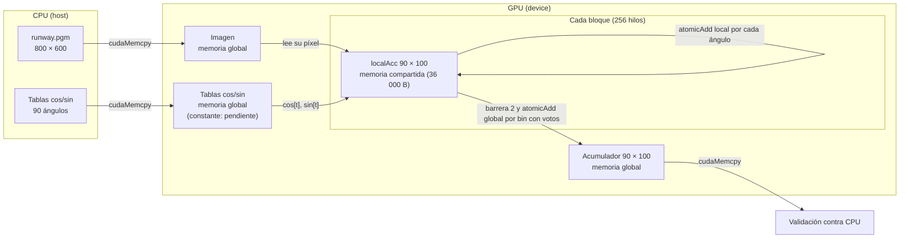

# Fase 5: memoria compartida

## Cambio realizado

`src/houghShared.cu` parte de la versión global (`src/houghBase.cu`, que no se modificó) y agrega un acumulador por bloque en memoria compartida. Esta es una **variante intermedia: global + compartida**. Las tablas de senos y cosenos siguen en memoria global; se pasarán a memoria constante al integrar `src/houghConst.cu` (fase 3) en la variante final con las tres memorias.

| Elemento | Versión global | Versión global + compartida |
| --- | --- | --- |
| Acumulador | un solo arreglo global; cada voto hace `atomicAdd` sobre él | `__shared__ int localAcc[9000]` por bloque; los votos van ahí y luego se suman al global |
| Tablas `cos`/`sin` | memoria global | memoria global (sin cambios; la constante se integra después) |
| Sincronización | ninguna | `__syncthreads()` dos veces por bloque |
| Argumentos del kernel | imagen, acumulador, `rMax`, `rScale`, punteros a tablas | los mismos |
| Memoria compartida por bloque | 0 bytes | 90 × 100 × 4 = 36 000 bytes |

La referencia CPU, la validación bin por bin, el manejo de errores y `cudaDeviceReset` son los mismos de la fase 1. Antes de lanzar el kernel, el programa consulta `sharedMemPerBlock` y termina con un error claro si la GPU no ofrece 36 000 bytes por bloque.

## Flujo por bloque

```text
Bloque (256 hilos)
 1. Todos los hilos ponen en cero localAcc (cada hilo borra elementos con paso blockDim.x)
 ── __syncthreads()  barrera 1 ──
 2. Cada hilo cuyo píxel está dentro de la imagen y es != 0:
       para t = 0..89:  atomicAdd(&localAcc[bin * 90 + t], 1)
 ── __syncthreads()  barrera 2 ──
 3. Todos los hilos recorren localAcc con paso blockDim.x:
       si localAcc[i] > 0:  atomicAdd(&acc[i], localAcc[i])     (acumulador global)
```

## Por qué se usa memoria compartida

- **Muchos hilos votan por los mismos bins.** En la imagen de 800 × 600 hay 138 406 píxeles activos y 12 456 540 votos sobre solo 9 000 bins. En la versión global todos esos `atomicAdd` compiten sobre las mismas direcciones en memoria global.
- **La memoria compartida es del bloque.** Es una memoria en el chip, visible solo para los hilos del mismo bloque. Los `atomicAdd` sobre `localAcc` se resuelven dentro del multiprocesador, sin salir a la memoria global.
- **El resultado de cada bloque se combina una sola vez.** Al final, cada bloque suma sus votos al acumulador global, solo en los bins que recibieron algún voto.

## Por qué dos barreras

- **Barrera 1** (después de inicializar): sin ella, un hilo rápido podría votar antes de que otro hilo termine de poner en cero su parte de `localAcc`, y ese voto se perdería al borrarse.
- **Barrera 2** (después de votar): sin ella, un hilo podría empezar a copiar `localAcc` al acumulador global mientras otros hilos del bloque todavía votan, y los votos tardíos no se sumarían.

## Bloque parcial

Si el número de píxeles no es múltiplo de 256, el último bloque tiene hilos sin píxel. Esos hilos **no regresan antes de las barreras**: la condición `gloID < totalPixels` envuelve solo el procesamiento del píxel. Así todos los hilos del bloque llegan a ambas barreras y también ayudan a inicializar y a volcar `localAcc`. Una barrera a la que no llegan todos los hilos del bloque produce comportamiento indefinido. En la imagen de 800 × 600 (480 000 píxeles, 1875 bloques exactos) no hay bloque parcial; por eso se agregan pruebas de 7 × 3 y 20 × 15.

## Diagrama conceptual



## Cómo ejecutarlo

1. Usar la rama `main`, que ya integra los avances de memoria compartida.
2. Abrir `notebooks/fase_compartida_colab.ipynb` en Google Colab con GPU (T4). El notebook clona `main`, compila, ejecuta las pruebas y descarga `results/compartida-validacion.txt`.

Comando de compilación equivalente:

```sh
mkdir -p build
nvcc -I. -O2 -std=c++17 --fmad=false src/houghShared.cu common/pgm.cpp -o build/hough_shared
./build/hough_shared data/runway.pgm
```

## Estado de la validación

**Comprobado localmente (sin GPU):** `src/houghShared.cu` pasa una revisión de sintaxis con `g++` usando un simulador mínimo de las funciones CUDA, tanto en la ruta de GPU como en `-DHOUGH_CPU_ONLY`. Esto **no** sustituye compilar con `nvcc` ni ejecutar en GPU.

**En GPU (Colab, Tesla T4, driver 580.82.07, CUDA 13.0 / nvcc V13.0.88):** todas las pruebas pasaron. Se ejecutó el commit `fa1e80ec3f17b3a9f80e00a6329d4fb6292f8dd0`, clonado de la rama `feat/memoria-compartida`, compilado con `nvcc -I. -O2 -std=c++17 --fmad=false src/houghShared.cu common/pgm.cpp -o build/hough_shared`. La salida completa está en [results/compartida-validacion.txt](../results/compartida-validacion.txt) y en las salidas guardadas de `notebooks/fase_compartida_colab.ipynb`.

| Caso | Bloques × hilos; píxeles en el último bloque | Resultado |
| --- | --- | --- |
| `data/runway.pgm` (800 × 600) | 1875 × 256; 256 (sin bloque parcial) | `VALIDACION OK`: CPU y GPU coinciden en todos los bins |
| 7 × 3 con 21 píxeles activos | 1 × 256; 21 (bloque parcial) | `VALIDACION OK` |
| 7 × 3 con píxeles negros | 1 × 256; 21 | `VALIDACION OK` |
| 20 × 15 con 300 píxeles activos | 2 × 256; 44 (el último es parcial) | `VALIDACION OK` |
| Sin argumentos y con archivo inexistente | no aplica | el programa devuelve código distinto de cero, como se esperaba |

El programa imprimió en cada ejecución `Memoria compartida por bloque: requerida 36000 bytes, limite GPU 49152 bytes`, así que la T4 permite el tamaño necesario (el límite de 49 152 bytes es el de memoria compartida estática por bloque). Los casos de 21 y 300 píxeles ejercitan las barreras con hilos que no tienen píxel; la imagen original no tiene bloque parcial porque 480 000 es múltiplo de 256.

Esta primera prueba usa las tablas trigonométricas en memoria global. Como la referencia CPU es la misma que en las demás variantes, un resultado idéntico a la CPU también la hace comparable con las versiones global y constante. No se midió el consumo de memoria compartida con `cuobjdump -res-usage`; el valor de 36 000 bytes proviene del cálculo 90 × 100 × 4 y de lo que imprime el programa.


- **Menos contención en el acumulador global**, porque los votos se resuelven dentro de cada bloque. Pero el volcado final no es gratuito: cada uno de los 1875 bloques puede escribir hasta 9 000 bins en el acumulador global (hasta 16.9 millones de `atomicAdd` globales en total, comparable con los 12.4 millones de votos de la versión global). La ganancia depende de cuántos bins distintos recibe cada bloque, y puede ser menor de lo esperado.
- **Ocupación limitada.** Con 36 000 bytes de memoria compartida por bloque, es probable que quepa un solo bloque por multiprocesador en la Tesla T4, lo que reduce el número de hilos activos. Esto se puede verificar con la API de ocupación de CUDA o con el perfilador antes de sacar conclusiones.
- **Costo de las barreras y de la inicialización**, que se repite en cada uno de los 1875 bloques.

La fase 6 medirá la variante con las tres memorias con CUDA Events (al menos 10 ejecuciones, misma GPU, imagen y configuración que las otras variantes) para confirmar o descartar estas hipótesis.

## Pendiente

- Integrar las tablas `__constant__` de la fase 3 (variante final con las tres memorias).
- Registrar al menos 10 tiempos con CUDA Events y consolidar la comparación con las otras dos variantes.
- Actualizar el diagrama con las tres memorias y redactar el efecto medido.

## Referencias

1. NVIDIA. *CUDA C++ Programming Guide*: secciones sobre memoria compartida, `__syncthreads()` y funciones atómicas. <https://docs.nvidia.com/cuda/cuda-c-programming-guide/>
2. NVIDIA. *CUDA C++ Best Practices Guide*: sección sobre memoria compartida. <https://docs.nvidia.com/cuda/cuda-c-best-practices-guide/>
3. Galindo, S. *Proyecto 3: CUDA*. Universidad del Valle de Guatemala (`docs/Proyecto 3 - CUDA.pdf`).
