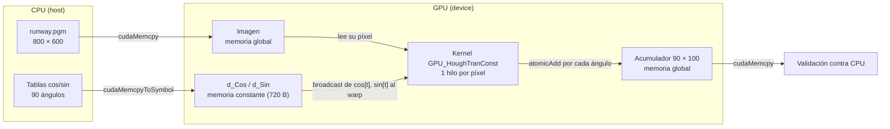

# Fase 3: memoria constante

## Cambio realizado

`src/houghConst.cu` parte de la versión global (`src/houghBase.cu`, que no se modificó) y solo cambia dónde viven las tablas trigonométricas:

| Elemento | Versión global | Versión global + constante |
| --- | --- | --- |
| Tablas `cos`/`sin` | `cudaMalloc` + `cudaMemcpy` | `__constant__ float d_Cos[90], d_Sin[90]` + `cudaMemcpyToSymbol` |
| Argumentos del kernel | imagen, acumulador, `rMax`, `rScale`, punteros a tablas | imagen, acumulador, `rMax`, `rScale` |
| Liberación de tablas | `cudaFree` (RAII) | no aplica: el símbolo existe mientras el módulo está cargado |
| Imagen y acumulador | memoria global | memoria global (sin cambios) |

Los símbolos se declaran fuera de `main`, con alcance de archivo, para que el kernel `GPU_HoughTranConst` los lea directamente. La referencia CPU, la validación bin por bin, el manejo de errores y `cudaDeviceReset` son los mismos de la fase 1.

## Por qué las tablas van en memoria constante

- **Son de solo lectura.** El host calcula los 90 cosenos y senos una vez; el kernel nunca los modifica.
- **Son las mismas para todos los píxeles.** Cada hilo recorre los mismos 90 ángulos, sin importar qué píxel procese.
- **Todos los hilos de un warp leen la misma dirección al mismo tiempo.** El índice `t` del ciclo es igual para todo el warp en cada iteración. La caché constante sirve una dirección por warp en una sola lectura y la reparte (broadcast) a los 32 hilos; según NVIDIA, en ese caso el acceso puede ser tan rápido como un registro. Si los hilos leyeran direcciones distintas, las lecturas se serializarían.
- **Son pequeñas.** 2 × 90 × 4 bytes = 720 bytes, muy por debajo del límite de 64 KB.

## Diagrama conceptual



## Cómo ejecutarlo

1. En la computadora: `make colab-package`.
2. Abrir `notebooks/constante_colab.ipynb` en Google Colab con GPU T4 y subir `build/proyecto-colab.zip`.
3. El notebook compila `build/hough` y `build/hough_const` con las mismas opciones, ejecuta las pruebas y descarga `results/constante-validacion.txt`.

Comando de compilación equivalente, con `build/pgm.o` generado por `make`:

```sh
nvcc -I. -O2 -std=c++17 --fmad=false src/houghConst.cu build/pgm.o -o build/hough_const
```

## Estado de la validación

**Comprobado localmente (sin GPU):**

- La ruta CPU de `houghConst.cu` compila con Clang (`-DHOUGH_CPU_ONLY`) y procesa `data/runway.pgm`: 138406 píxeles activos y 12456540 votos, igual que la versión global.
- El código CUDA (kernel y host) pasa una revisión de sintaxis con Clang en modo CUDA para `sm_75`. Esto **no** sustituye compilar con `nvcc` ni ejecutar en GPU.

**En GPU (Colab, Tesla T4, driver 580.82.07, CUDA 13.0 / nvcc V13.0.88):** todas las pruebas pasaron. La salida completa está en [results/constante-validacion.txt](../results/constante-validacion.txt). Se ejecutó el commit `94d5c0e`, clonado de la rama en lugar de subir el ZIP; las celdas de compilación y validación se corrieron sin cambios.

- Imagen original de 800 × 600, 1875 bloques de 256 hilos: la versión global y la constante coinciden con la CPU en todos los bins. Como ambas se comparan contra la misma referencia, también coinciden entre sí.
- Imagen de 7 × 3 con 21 píxeles activos (bloque parcial) e imagen negra: sin diferencias CPU/GPU.
- Sin argumentos y con archivo inexistente: la variante constante devuelve error, como se esperaba.

`cuobjdump -res-usage` confirma que las tablas viven en memoria constante:

| Kernel | Memoria constante del módulo | Parámetros del kernel (`CONSTANT[0]`) |
| --- | --- | --- |
| `GPU_HoughTran` (global) | ninguna | 400 bytes |
| `GPU_HoughTranConst` | `CONSTANT[3]: 720` bytes, exactamente `d_Cos` + `d_Sin` | 384 bytes |

Los 16 bytes menos en los parámetros corresponden a los dos punteros a tablas que el kernel ya no recibe. Ambos kernels usan 16 registros, sin memoria compartida ni local.

## Hipótesis sobre el tiempo (por medir en la fase 4)

Todavía no hay mediciones, así que no se afirma ninguna mejora. Lo que se espera comprobar:

- La mejora podría ser pequeña. En la Tesla T4 (Turing), las lecturas globales también pasan por las cachés L1/L2, y cuando un warp lee una misma dirección global se atiende con una sola transacción. Una tabla de 720 bytes cabe completa en caché en ambas versiones.
- Es probable que domine el costo de los `atomicAdd` sobre el acumulador global: cada píxel activo emite 90 votos, unos 12.4 millones de atómicos sobre solo 9000 bins.

La fase 4 medirá ambas versiones con CUDA Events (al menos 10 ejecuciones cada una, misma GPU y configuración) para confirmar o descartar estas hipótesis.

## Referencias

1. NVIDIA. *CUDA C++ Best Practices Guide*, sección 10.2.6 "Constant Memory". <https://docs.nvidia.com/cuda/cuda-c-best-practices-guide/index.html#constant-memory>
2. NVIDIA. *CUDA Programming Guide*, sección 2.3.3.5 "Constant Memory". <https://docs.nvidia.com/cuda/cuda-programming-guide/02-basics/writing-cuda-kernels.html#constant-memory>
3. NVIDIA. *CUDA Runtime API*, "Memory Management": `cudaMemcpyToSymbol`. <https://docs.nvidia.com/cuda/cuda-runtime-api/cuda_runtime_api/group__CUDART__MEMORY.html>
4. Galindo, S. *Proyecto 3: CUDA*. Universidad del Valle de Guatemala (`docs/Proyecto 3 - CUDA.pdf`).
