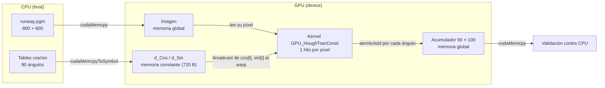

# Fases 3 y 4: memoria constante

## Cambio realizado

`src/houghConst.cu` parte de la versión global (`src/houghBase.cu`, que no se modificó) y solo cambia dónde viven las tablas trigonométricas:

| Elemento | Versión global | Versión global + constante |
| --- | --- | --- |
| Tablas `cos`/`sin` | `cudaMalloc` + `cudaMemcpy` | `__constant__ float d_Cos[90], d_Sin[90]` + `cudaMemcpyToSymbol` |
| Argumentos del kernel | imagen, acumulador, `rMax`, `rScale`, punteros a tablas | imagen, acumulador, `rMax`, `rScale` |
| Liberación de tablas | `cudaFree` (RAII) | no aplica: el símbolo existe mientras el módulo está cargado |
| Imagen y acumulador | memoria global | memoria global (sin cambios) |

Los símbolos se declaran fuera de `main`, con alcance de archivo, para que el kernel `GPU_HoughTranConst` los lea directamente. La referencia CPU, la validación bin por bin, el manejo de errores y `cudaDeviceReset` son los mismos de la fase 1.

## Por qué las tablas van en memoria constante

- **Son de solo lectura.** El host calcula los 90 cosenos y senos una vez; el kernel nunca los modifica.
- **Son las mismas para todos los píxeles.** Cada hilo recorre los mismos 90 ángulos, sin importar qué píxel procese.
- **Todos los hilos de un warp leen la misma dirección al mismo tiempo.** El índice `t` del ciclo es igual para todo el warp en cada iteración. La caché constante sirve una dirección por warp en una sola lectura y la reparte (broadcast) a los 32 hilos; según NVIDIA, en ese caso el acceso puede ser tan rápido como un registro. Si los hilos leyeran direcciones distintas, las lecturas se serializarían.
- **Son pequeñas.** 2 × 90 × 4 bytes = 720 bytes, muy por debajo del límite de 64 KB.

## Diagrama conceptual



## Cómo ejecutarlo

En un equipo CUDA, desde la raíz del repositorio:

```sh
make build/hough_const
./build/hough_const data/runway.pgm --runs 10 --output results/mi-sesion
```

`--runs` y `--output` funcionan igual que en la versión global: un calentamiento excluido, `--runs` mediciones del kernel con CUDA Events validadas contra la CPU y `constante-times.csv` con las mismas columnas que `global-times.csv`.

En Google Colab:

- **Validación (fase 3):** `notebooks/constante_colab.ipynb`. Sube `build/proyecto-colab.zip`, generado con `make colab-package`, y descarga `results/constante-validacion.txt`.
- **Tiempos (fase 4):** `notebooks/fase4_constante_colab.ipynb`. Clona la rama indicada en `RAMA` (por defecto `main`), compila `build/hough` y `build/hough_const`, y guarda los resultados en `results/fase4-constante/final/`.

## Estado de la validación

**Comprobado localmente (sin GPU):**

- La ruta CPU de `houghConst.cu` compila con Clang (`-DHOUGH_CPU_ONLY`) y procesa `data/runway.pgm`: 138406 píxeles activos y 12456540 votos, igual que la versión global.
- El código CUDA (kernel y host) pasa una revisión de sintaxis con Clang en modo CUDA para `sm_75`. Esto **no** sustituye compilar con `nvcc` ni ejecutar en GPU.

**En GPU (Colab, Tesla T4, driver 580.82.07, CUDA 13.0 / nvcc V13.0.88):** todas las pruebas pasaron. La salida completa está en [results/constante-validacion.txt](../results/constante-validacion.txt). Se ejecutó el commit `94d5c0e`, clonado de la rama en lugar de subir el ZIP; las celdas de compilación y validación se corrieron sin cambios.

- Imagen original de 800 × 600, 1875 bloques de 256 hilos: la versión global y la constante coinciden con la CPU en todos los bins. Como ambas se comparan contra la misma referencia, también coinciden entre sí.
- Imagen de 7 × 3 con 21 píxeles activos (bloque parcial) e imagen negra: sin diferencias CPU/GPU.
- Sin argumentos y con archivo inexistente: la variante constante devuelve error, como se esperaba.

`cuobjdump -res-usage` confirma que las tablas viven en memoria constante:

| Kernel | Memoria constante del módulo | Parámetros del kernel (`CONSTANT[0]`) |
| --- | --- | --- |
| `GPU_HoughTran` (global) | ninguna | 400 bytes |
| `GPU_HoughTranConst` | `CONSTANT[3]: 720` bytes, exactamente `d_Cos` + `d_Sin` | 384 bytes |

Los 16 bytes menos en los parámetros corresponden a los dos punteros a tablas que el kernel ya no recibe. Ambos kernels usan 16 registros, sin memoria compartida ni local.

## Fase 4: efecto en el tiempo

### Método

Las dos versiones se midieron en la **misma sesión de Colab y la misma Tesla T4** (driver 580.82.07, CUDA 13.0), con la misma imagen de 800 × 600, 1875 bloques de 256 hilos y las mismas opciones de compilación (`-O2 -std=c++17 --fmad=false`). `houghConst.cu` usa el protocolo de la fase 2 de la versión global: dos CUDA Events rodean solo el lanzamiento del kernel; el acumulador se pone en cero antes de cada medición, fuera del intervalo, y en cada medición se comparan los 9000 bins con la CPU.

El notebook `notebooks/fase4_constante_colab.ipynb` (commit `e814977`) sigue estos pasos:

1. Estabiliza la GPU con 2000 ejecuciones descartadas.
2. Alterna cuatro rondas en orden ABBA (global → constante, constante → global, global → constante, constante → global) para cancelar cualquier deriva lineal.
3. En cada ejecución hace 100 mediciones y reporta las últimas 10, así que quedan 40 mediciones por versión.
4. Registra el estado P, la frecuencia, la temperatura y la potencia de la GPU antes y después de cada ejecución.

### Resultados

Promedio ± desviación estándar muestral, en milisegundos. Detalle en [results/fase4-constante/final/](../results/fase4-constante/final/).

| Ronda | Orden | Global | Constante | Diferencia | p (Welch) |
| --- | --- | --- | --- | --- | --- |
| 1 | global → constante | 0.8711 ± 0.0034 | 0.8521 ± 0.0032 | −2.18 % | 1.9 × 10⁻¹⁰ |
| 2 | constante → global | 0.8628 ± 0.0039 | 0.8499 ± 0.0045 | −1.50 % | 2.2 × 10⁻⁶ |
| 3 | global → constante | 0.8603 ± 0.0043 | 0.8493 ± 0.0071 | −1.27 % | 8.3 × 10⁻⁴ |
| 4 | constante → global | 0.8698 ± 0.0030 | 0.8526 ± 0.0036 | −1.97 % | 1.2 × 10⁻⁹ |
| **Total (40 por versión)** | | **0.8660 ± 0.0058** | **0.8510 ± 0.0049** | **−1.73 %** | **4.3 × 10⁻²⁰** |

Speedup global / constante: **1.018**. La GPU estuvo en P0 a 1590 MHz en las 16 lecturas, y los promedios de los lanzamientos 1–10, 11–90 y 91–100 de cada ejecución difieren a lo sumo 1.2 %, así que la frecuencia se mantuvo estable. Las 800 mediciones coincidieron con la CPU.

### Análisis

La memoria constante se aplicó a las tablas trigonométricas. El host calcula una vez los cosenos y senos de los 90 ángulos y los copia con `cudaMemcpyToSymbol` a `d_Cos` y `d_Sin`, declarados `__constant__` con alcance de archivo. El kernel ya no recibe punteros a esas tablas y lee `d_Cos[t]` y `d_Sin[t]` en cada ángulo; la imagen y el acumulador siguen en memoria global. Con la GPU estable, la versión constante fue más rápida en las cuatro rondas, sin importar el orden, y bajó el tiempo promedio del kernel de 0.8660 a 0.8510 ms. La mejora de 1.73 % es pequeña, pero consistente y estadísticamente significativa.

**¿Por qué la mejora es pequeña?**

- **La versión global ya lee las tablas desde caché.** Las tablas ocupan 720 bytes y en la versión global también caben en las cachés L1/L2 de la T4. Como todos los hilos de un warp leen el mismo índice `t`, el hardware atiende esa lectura global con una sola transacción por warp. La memoria constante evita la ruta de carga global y su latencia, pero en ninguna de las dos versiones se leen las tablas repetidamente desde DRAM.
- **El costo dominante son las operaciones atómicas.** Los 138 406 píxeles activos emiten 90 votos cada uno, unos 12.46 millones de `atomicAdd` sobre solo 9000 contadores en memoria global, y muchos hilos compiten por los mismos bins. Esa contención es la que ataca la memoria compartida (fase 5).
- **Las lecturas de tabla son una parte pequeña del trabajo de cada voto.** Además de las dos lecturas, cada voto hace varias operaciones aritméticas, una división, la conversión y el ajuste del bin, y el atómico.

### Lecciones de la medición

Antes de la medición final hubo dos pruebas, conservadas como evidencia:

- **[exploratorio/](../results/fase4-constante/exploratorio/)** (commit `a65dac5`): sin estabilizar la GPU, los tiempos bajaron de 1.43 a 1.18 ms durante la sesión mientras la GPU salía de reposo (P8), sin importar la versión. Según el orden, la constante parecía 4.9 % más rápida o 4.3 % más lenta.
- **[frecuencia-variable/](../results/fase4-constante/frecuencia-variable/)** (commit `efaddf6`): ya con la GPU estabilizada, las rondas 1 y 2, ambas a 1590 MHz, mostraron −2.2 % y −2.7 %. Desde la ronda 3 la frecuencia bajó a 1185–1380 MHz, porque con solo 11 kernels de menos de 1 ms por ejecución la GPU pasa casi todo el tiempo sin trabajo, y la comparación dejó de ser válida.

Por esta razón, los tiempos absolutos de sesiones distintas no son comparables. La medición global de la fase 2 (1.555 ms) se hizo con la GPU en P8 antes de medir, según su log, igual que la prueba exploratoria. La comparación de esta fase usa la versión global medida de nuevo en la misma sesión (0.866 ms). Para la comparación final de las tres variantes se recomienda medirlas juntas, en una sola sesión, con este protocolo: basta agregar `build/hough_shared` al notebook.

## Referencias

1. NVIDIA. *CUDA C++ Best Practices Guide*, sección 10.2.6 "Constant Memory". <https://docs.nvidia.com/cuda/cuda-c-best-practices-guide/index.html#constant-memory>
2. NVIDIA. *CUDA Programming Guide*, sección 2.3.3.5 "Constant Memory". <https://docs.nvidia.com/cuda/cuda-programming-guide/02-basics/writing-cuda-kernels.html#constant-memory>
3. NVIDIA. *CUDA Runtime API*, "Memory Management": `cudaMemcpyToSymbol`. <https://docs.nvidia.com/cuda/cuda-runtime-api/cuda_runtime_api/group__CUDART__MEMORY.html>
4. NVIDIA. *How to Implement Performance Metrics in CUDA C/C++*. <https://developer.nvidia.com/blog/how-implement-performance-metrics-cuda-cc/>
5. Galindo, S. *Proyecto 3: CUDA*. Universidad del Valle de Guatemala (`docs/Proyecto 3 - CUDA.pdf`).
