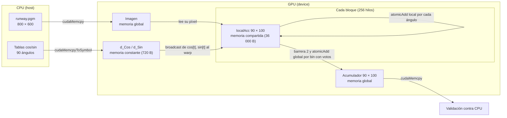

# Fases 5 y 6: variante con las tres memorias y comparación final

## Cambio realizado

`src/houghSharedConst.cu` (ejecutable `build/hough_final`) parte de `src/houghConst.cu` y le agrega el acumulador por bloque de `src/houghShared.cu`. Las tres variantes se conservan como ejecutables independientes.

| Elemento | Global (`build/hough`) | Global + constante (`build/hough_const`) | Global + constante + compartida (`build/hough_final`) |
| --- | --- | --- | --- |
| Kernel | `GPU_HoughTran` | `GPU_HoughTranConst` | `GPU_HoughTranSharedConst` |
| Tablas `cos`/`sin` | memoria global, punteros como argumentos | `__constant__ d_Cos[90]`, `d_Sin[90]` | `__constant__ d_Cos[90]`, `d_Sin[90]` |
| Votos | `atomicAdd` directo al acumulador global | `atomicAdd` directo al acumulador global | `atomicAdd` sobre `__shared__ int localAcc[9000]` del bloque; luego un `atomicAdd` global por bin con votos |
| Barreras `__syncthreads()` | 0 | 0 | 2 (todos los hilos del bloque llegan a ambas) |
| Memoria constante | 0 B | 720 B | 720 B |
| Memoria compartida por bloque | 0 B | 0 B | 36 000 B (90 × 100 × 4) |
| Configuración | 1875 bloques × 256 hilos | igual | igual |

La referencia CPU, la validación bin por bin, el manejo de errores y `cudaDeviceReset` son los mismos en las tres variantes. El programa final imprime `Memoria constante: 720 bytes; memoria compartida por bloque: requerida 36000 bytes, limite GPU 49152 bytes` y termina con error si la GPU no ofrece los 36 000 bytes.

## Diagrama conceptual



## Método

Las tres variantes se midieron en la **misma sesión de Colab y la misma Tesla T4** (driver 580.82.07, CUDA 13.0, nvcc V13.0.88), con `data/runway.pgm` (800 × 600), las mismas opciones de compilación (`-O2 -std=c++17 --fmad=false`) y el notebook `notebooks/fase6_tres_memorias_colab.ipynb` sobre el commit `95049968a8d6e87b2783c224ba030b8cb68e8bf6` de `main`. Protocolo, igual que en la fase 4 para las dos primeras variantes:

1. Dos CUDA Events rodean solo el lanzamiento del kernel. El acumulador se pone en cero antes de cada medición, fuera del intervalo, y en cada medición se comparan los 9000 bins con la CPU.
2. 2000 ejecuciones descartadas para estabilizar la GPU.
3. **6 rondas, una por cada permutación del orden** de las tres variantes. Cada variante ocupa dos veces cada posición (primera, segunda, tercera), lo que cancela la deriva de la GPU y el efecto de la variante anterior.
4. En cada ejecución, 1 calentamiento + 100 lanzamientos medidos; se reportan los **últimos 10**. Resultan 60 mediciones por variante, todas validadas contra la CPU.

El estado de la GPU antes y después de cada ejecución está en `estado-gpu.csv`: siempre P0, 1575–1590 MHz de reloj de SM y 64–66 °C durante las rondas.

## Resultados

Promedio ± desviación estándar muestral, en milisegundos, últimos 10 lanzamientos de cada ejecución. Detalle en `results/fase6-tres-memorias/final/`.

| Ronda | Orden | Global | Constante | Tres memorias |
| --- | --- | --- | --- | --- |
| 1 | global → constante → tres | 0.9014 ± 0.0043 | 0.8565 ± 0.0044 | 0.7379 ± 0.0019 |
| 2 | global → tres → constante | 0.9014 ± 0.0046 | 0.8663 ± 0.0042 | 0.7320 ± 0.0015 |
| 3 | constante → global → tres | 0.8981 ± 0.0055 | 0.8635 ± 0.0034 | 0.7319 ± 0.0021 |
| 4 | constante → tres → global | 0.8881 ± 0.0067 | 0.8627 ± 0.0027 | 0.7375 ± 0.0007 |
| 5 | tres → global → constante | 0.9040 ± 0.0040 | 0.8497 ± 0.0037 | 0.7396 ± 0.0011 |
| 6 | tres → constante → global | 0.9089 ± 0.0055 | 0.8704 ± 0.0070 | 0.7407 ± 0.0013 |
| **Total (60 por variante)** | | **0.9003 ± 0.0081** | **0.8615 ± 0.0080** | **0.7366 ± 0.0038** |

| Comparación (total) | Diferencia | Speedup | p (Welch, Bonferroni ×3) |
| --- | --- | --- | --- |
| Constante frente a global | −4.31 % | 1.045 | 8.9 × 10⁻⁵¹ |
| Tres memorias frente a global | **−18.19 %** | **1.222** | 1.4 × 10⁻¹⁰⁰ |
| Tres memorias frente a constante | −14.50 % | 1.170 | 9.2 × 10⁻⁹² |

El orden tres memorias < constante < global se cumplió en las seis rondas, es decir, sin importar en qué posición se ejecutó cada variante. Por ronda, la variante final fue entre 17.0 % y 18.8 % más rápida que la global y entre 13.0 % y 15.5 % más rápida que la constante.

## Análisis

**Cómo se aplicó la memoria compartida y su efecto.** Cada bloque de 256 hilos acumula sus votos en `localAcc`, un arreglo de 9000 enteros en memoria compartida, y solo al final suma ese acumulador al global. En la imagen de 800 × 600, 138 406 píxeles activos emiten 90 votos cada uno (12 456 540 votos) sobre solo 9000 bins, así que en las versiones anteriores muchísimos hilos compiten por las mismas direcciones globales. Con `localAcc`, esa competencia se resuelve dentro de cada multiprocesador y al global solo llega el volcado de cada bloque. El kernel con las tres memorias promedió **0.7366 ms**, frente a 0.8615 ms de la constante y 0.9003 ms de la global: 14.5 % menos que la constante y 18.2 % menos que la global. Como la constante solo aporta 4.3 % sobre la global, la mayor parte de la mejora de la variante final se debe a la memoria compartida. Esta atribución supone que ambas mejoras se suman; la variante intermedia global + compartida (`build/hough_shared`) no se midió con este protocolo.

**La medición es sensible a qué lanzamientos se reportan.** Al promediar por tramo de cada ejecución de 100 lanzamientos (seis ejecuciones por variante), los tiempos de la global y la constante suben a lo largo de la ejecución, mientras que los de la variante final no:

| Tramo de la ejecución | Global | Constante | Tres memorias | Constante vs global | Tres vs global |
| --- | --- | --- | --- | --- | --- |
| Lanzamientos 1–10 | 0.8638 | 0.8494 | 0.7395 | −1.7 % | −14.4 % |
| Lanzamientos 11–90 | 0.8770 | 0.8512 | 0.7374 | −3.0 % | −15.9 % |
| Lanzamientos 91–100 (reportados) | 0.9003 | 0.8615 | 0.7366 | −4.3 % | −18.2 % |
| Los 100 lanzamientos | 0.8780 | 0.8520 | 0.7375 | −3.0 % | −16.0 % |

La conclusión cualitativa no cambia en ningún tramo (la variante final es entre 14 % y 18 % más rápida que la global), pero la cifra exacta depende del tramo. Con los 100 lanzamientos la mejora sería de 16.0 % y no de 18.2 %. No se determinó la causa de la subida de la global: los relojes de SM bajaron de 1590 a 1575 MHz (alrededor de 1 %) al final de cinco de las seis ejecuciones globales, lo cual no alcanza para explicar un aumento de 4 %, y no se midieron potencia ni temperatura de forma continua. Por eso se reportan los últimos 10 lanzamientos por consistencia con la fase 4, y se deja constancia de esta sensibilidad en lugar de elegir el tramo más favorable.

**Frente a la fase 4.** En la sesión de la fase 4 la global promedió 0.8660 ms y la constante 0.8510 ms (−1.73 %); aquí, 0.9003 ms y 0.8615 ms (−4.31 %). Los tiempos absolutos de sesiones distintas no son comparables (la GPU estaba a 64–66 °C en esta sesión y a 43 °C en la anterior), y la ventaja de la constante varió entre 1.7 % y 4.3 % según la sesión y el tramo. En todos los casos fue pequeña y estadísticamente significativa, y la explicación de la fase 4 se mantiene: las tablas ya se leían desde caché y el costo dominante son los atómicos sobre el acumulador.

**Estado de las hipótesis planteadas en la fase 5.**

| Hipótesis | Estado |
| --- | --- |
| La memoria compartida reduce la contención sobre el acumulador global | **Consistente con la medición** (−14.5 % frente a la constante). No se confirmó con un perfilador. |
| El volcado final (hasta 9000 `atomicAdd` globales por bloque) limita la ganancia | No medido directamente. Es una explicación posible de que la mejora no sea mayor. |
| 36 000 B por bloque limitan la ocupación a un bloque por multiprocesador | **No verificado.** Revisar `res-usage.txt` y calcular la ocupación con la API de CUDA o con Nsight antes de afirmarlo. |
| El costo de las barreras y de la inicialización es relevante | No separado de los demás costos. La ganancia neta fue positiva. |

Otra observación sin explicación causal: la variante final tuvo menos variación entre mediciones (desviación total de 0.0038 ms frente a 0.0081 y 0.0080 ms) y no mostró la subida dentro de cada ejecución que sí aparece en las otras dos.

## Limitaciones

- Una sola imagen (800 × 600, con 138 406 píxeles activos) y una sola GPU (Tesla T4). La ganancia depende de cuántos píxeles activos haya y de cuánta competencia exista por los bins.
- Las 60 mediciones por variante provienen de 6 ejecuciones, y las mediciones dentro de una ejecución están correlacionadas. Los valores p de Welch tratan las 60 mediciones como independientes, así que sobrestiman la certeza estadística; la consistencia en las seis rondas es el argumento más sólido.
- No se usó un perfilador. Las explicaciones del mecanismo son hipótesis coherentes con los tiempos, no mediciones.

## Conclusiones

1. Las tres variantes producen el mismo acumulador que la CPU en las 18 ejecuciones del programa de la comparación (6 rondas × 3 variantes), cada una con 100 lanzamientos medidos validados, 1800 en total.
2. La memoria compartida es la optimización que más importa en este problema: la variante final fue 18.2 % más rápida que la global (speedup de 1.22) con los últimos 10 lanzamientos, y 16.0 % con los 100.
3. La memoria constante aporta una mejora pequeña pero consistente (entre 1.7 % y 4.3 %).
4. Recomendación: antes de atribuir el resultado a la ocupación o al volcado, perfilar con Nsight Compute y medir `build/hough_shared` (global + compartida) con este mismo protocolo para separar el efecto de cada memoria.

## Salida gráfica de la variante final

Con `--output directorio`, `build/hough_final` exporta tanto `tres-memorias-times.csv` como `tres-memorias-accumulator.json`, después de validar todos los lanzamientos. El acumulador incluye las tablas exactas y la etiqueta `tres_memorias`. La exportación ocurre fuera del intervalo CUDA Events y utiliza la misma función que la variante global.

`notebooks/salida_final_colab.ipynb` ejecuta la versión final y genera su PNG a través de `scripts/render_lines.py`. Falta incorporar el ZIP real de esta nueva validación GPU; las mediciones comparativas de esta página se conservan y corresponden al commit anterior al ajuste de exportación. No se ha cambiado el kernel ni el protocolo medido.

## Cómo reproducirlo

```sh
make
./build/hough_final data/runway.pgm --runs 10 --output results/mi-sesion
```

Para repetir la comparación completa, abrir `notebooks/fase6_tres_memorias_colab.ipynb` en Colab con GPU T4. El notebook clona la rama indicada en `RAMA`, compila las tres variantes, ejecuta las seis rondas y guarda CSV, log, resumen, comparación, `res-usage.txt` y la gráfica en `results/fase6-tres-memorias/final/`.

## Referencias

1. NVIDIA. *CUDA C++ Programming Guide*: secciones sobre memoria compartida, `__syncthreads()` y funciones atómicas. <https://docs.nvidia.com/cuda/cuda-c-programming-guide/>
2. NVIDIA. *CUDA C++ Best Practices Guide*: secciones sobre memoria compartida y memoria constante. <https://docs.nvidia.com/cuda/cuda-c-best-practices-guide/>
3. NVIDIA. *How to Implement Performance Metrics in CUDA C/C++*. <https://developer.nvidia.com/blog/how-implement-performance-metrics-cuda-cc/>
4. Galindo, S. *Proyecto 3: CUDA*. Universidad del Valle de Guatemala (`docs/Proyecto 3 - CUDA.pdf`).
